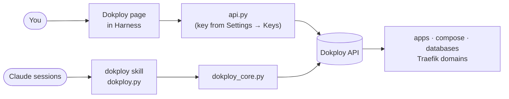

# Dokploy for Harness Maxxing

[](https://github.com/Anthony14FR/harness-maxxing-dokploy/actions/workflows/ci.yml)
[](LICENSE)
[](https://github.com/makushingu/harness-maxxing)
[](https://dokploy.com)
[](pyproject.toml)

**Your [Dokploy](https://dokploy.com) inside [Harness Maxxing](https://github.com/makushingu/harness-maxxing).** See every
app, stack, database and domain, deploy, roll back and read logs from one page, and let your Claude sessions do the
same, always asking you first.

A community [page extension](https://github.com/makushingu/harness-maxxing/blob/main/docs/user/13-page-extensions.md):
one `git clone`, nothing changed in Harness or Dokploy.



## Features

- **A full dashboard, no need to open Dokploy** - updates on top, then six tabs:
  - **Overview**: what needs your attention (failed deployments, disk or memory almost full, HTTP-only domains,
    queue), counters, CPU / memory / disk, recent deployments;
  - **Services**: every app, stack and database with its last deployment, the containers really running
    (`running 2/2`, `partly down`, `down`), its domains and its actions; search and a Problems filter; **Logs**: what
    its container prints now (pick the container of a stack, a period, a search, **Follow** every 3 s);
  - **Domains**: every domain, HTTPS or not, the certificate visitors really get (days left, issuer, trusted or not),
    and the ones a compose routes with its own Traefik labels;
  - **Databases**: their containers and their backups (schedule, last run, destination), with **Back up now**;
  - **Deployments**: apps, stacks and backups, failed or in progress, with duration, error and log;
  - **Server**: **live usage** (CPU and memory of every service and of all containers, sampled every 5 s while the
    tab is open, last 5 minutes), resources, Dokploy's database and Traefik (version, update available), public IP, Docker disk usage,
    remote servers, and **Clear the build cache**: the only cleanup offered (`docker builder prune`, refused while a
    build runs). Volumes (your data), images (what a rollback starts again), containers and databases are never
    touched: Dokploy's other cleanups are not reachable from here.
- **Made for every screen** - tables turn into cards on a phone, 44 px touch targets, keyboard tabs (arrows, Home,
  End), no color without a word, Harness's own colors and icons in light and dark, English or French as Harness is set.
- **Actions that ask first** - Deploy, Rebuild, Roll back, Stop, Start, Restart one container, Scale an application's
  replicas. When the site can be down for a few seconds,
  you type the service name to confirm.
- **Protected services** - mark production read-only: the page and the sessions refuse every write until you lift it.
- **Claude knows Dokploy** - a skill to list what runs, explain a failed deployment from its log, deploy, add a
  domain or create an app from a git repository, with your yes before any change.
- **One-click updates** - the extension, Dokploy itself and a link to Harness's own updates, each checked before it
  runs.
- **The key stays put** - read from Harness's vault on each call, never shown to sessions, never sent anywhere but
  your Dokploy.

## Install

Needs Harness Maxxing with page extensions and a Dokploy the Harness server can reach (tested v0.30.10, v0.31.0).

1. **Clone** on the Harness server, as root (`/root/maxxing` is the default workspace):

   ```bash
   git clone https://github.com/Anthony14FR/harness-maxxing-dokploy.git /root/maxxing/extensions/dokploy
   ```

2. **Rescan**: Settings → Pages → **Rescan**. **Dokploy** appears in the sidebar by itself (once: if you unpin it,
   it stays unpinned; on a Harness where that fails, turn on **In the sidebar** there).
3. **Key**: in Dokploy, Settings → Profile → **API/CLI Keys** → **Generate New Key** (shown once). In Harness,
   Settings → Keys → **Add a key**: `DOKPLOY_API_KEY`, and leave **Expose to Harness sessions** off.
4. **Connect**: on the Dokploy page, check the address (default `http://127.0.0.1:3000`) → **Check and connect**.
5. **Sessions**: click **Link the skill for sessions** (once: the link follows every update).

<details>
<summary>Linking the skill by hand, and coming from 1.x</summary>

```bash
mkdir -p /root/maxxing/.claude/skills
ln -s /root/maxxing/extensions/dokploy/skill/dokploy /root/maxxing/.claude/skills/dokploy
```

Do not edit the linked `SKILL.md`: a local change blocks the extension's updates. From 1.x nothing breaks: the old
copy keeps working; the button (or `dokploy.py link-skill`, not `ln -s` over the existing folder) moves it aside,
makes the link and puts the copy back if anything fails. A folder holding your own files is left alone.
</details>

## Alerts

Overview → **Alerts** → **Turn alerts on** creates a Harness cron job, **Dokploy alerts**, that runs
`dokploy.py alerts` every 5 minutes. Each new problem reaches Harness notifications once, then its end once:

| Problem | Level |
|---|---|
| A deployment or a backup failed (the last 6 hours) | error |
| A service is down: none of its containers runs although its last deployment succeeded | error, then "back up" |
| Disk at 90 % or more, memory at 95 % or more | warning, then "below" |
| Traefik's last update failed; Dokploy does not answer | warning / error, then cleared |
| A certificate expires within 14 days, or is not trusted (self-signed, wrong name) | warning, then "fine again" |

The check only reads Dokploy. Telegram follows the rule of the **Dokploy** source in Settings → Notifications. Turn
alerts off from the same card (the job stays, disabled); `dokploy.py alerts --dry-run` prints what it would post.

## Update

On the Dokploy page: **Updates → Check for updates**.

| Part | What happens |
|---|---|
| **This extension** | **Update** only when clean: no local change, fast-forward, its GitHub checks passed, supported by your Harness. Pulls exactly the commit you saw, refreshes the skill, reloads the page. |
| **Dokploy** | Type `dokploy` to confirm; Dokploy updates itself to its latest release. Sites stay up; Dokploy's own page is away about two minutes. |
| **Traefik** | When Dokploy recommends a newer Traefik: type `traefik` to confirm (also in the Server tab). Dokploy pulls the image, then recreates Traefik with its environment and ports; your sites can be unreachable for a few seconds. The page follows it until Traefik runs the new version, or shows Dokploy's error (a failed update keeps the previous Traefik: measured on a test server, the sites stayed up). Needs Dokploy v0.31 or later. |
| **Harness Maxxing** | Link to Settings → Updates (its own checks and rollback). |

By hand, the same as the button: `git -C /root/maxxing/extensions/dokploy pull --ff-only`. Folder owned by another
user: `git config --global --add safe.directory /root/maxxing/extensions/dokploy`.

## For Claude sessions

```bash
D=/root/maxxing/extensions/dokploy/dokploy.py
python3 $D list                     # everything, with last deployment and domains
python3 $D health APP               # containers really running + routed hosts
python3 $D logs APP                 # last deployment log
python3 $D container-logs APP       # what its container prints now (--since 1h --search TEXT)
python3 $D deploy APP --yes         # every write needs --yes, added only after you agreed
```

<details>
<summary>All commands</summary>

```bash
python3 $D status | link-skill | updates [--json]
python3 $D list | environments [--json]
python3 $D deployments | health APP [--json]
python3 $D logs APP [--deployment ID] [--lines N]
python3 $D container-logs APP [--container ID] [--lines N] [--since 1h] [--search TEXT]
python3 $D domain list APP
python3 $D deploy | redeploy | stop | start | rollback APP --yes
python3 $D restart APP --container ID --yes        # one of its containers (ids: health --json)
python3 $D scale APP REPLICAS --yes                 # applications: 0 to 20, applied by a reload
python3 $D domain add APP HOST [--port N] [--path P] [--service S] [--no-https] --yes
python3 $D app create --environment ID --name N --repo URL [--branch B] [--build T] --yes
```

Without `--yes` a write stops (exit 3) and changes nothing. A protected service refuses every write, even with
`--yes`, and there is no command to lift it. Values passed to Dokploy (git URL, branch, names, host, port, path) are
validated first.
</details>

## Security

> **Community extension, not reviewed by the Harness Maxxing maintainers.** Like every extension, `api.py` runs
> inside the Harness server with its rights (root on a standard install). Read the code before installing it.

- **One destination**: only the Dokploy address you checked, with the key in `x-api-key` (and, for certificates, a TLS
  handshake to that same address with each HTTPS domain's name: no key, nothing sent; `certificates.all` is never
  called, it returns private keys). No telemetry, no redirect
  followed, `https://` required outside this machine, a private network or Tailscale.
- **The key**: lives only in Settings → Keys; read per call (`ctx.secret()` for the page, `maxxing keys get` for the
  script), never written here, printed or put in a session's environment. The state folder keeps the address, a
  fingerprint of the key and the protected services.
- **Updates**: only when you click: Dokploy's version calls, `git fetch` / `merge --ff-only` of this folder, and
  GitHub's public check-runs API (no token).
- **Limits**: `--yes` and protection guide the page and the commands Claude is told to use; they are not a wall
  against a root session set on going around them. Deployment logs can contain what a build printed.

<details>
<summary>Every Dokploy call it makes</summary>

- Reads: `project.all`, `application.one`, `compose.one`, `deployment.all`, `deployment.allByCompose`,
  `docker.getContainersByAppNameMatch`, `docker.getStackContainersByAppName`, `docker.getConfig` (a compose's running
  containers: only their Traefik routing labels are kept, the rest, environment included, is dropped at once).
- Dashboard reads: `project.homeStats`, `docker.getServerHealth`, `docker.getContainers`,
  `settings.checkInfrastructureHealth`, `settings.getTraefikOverview`, `settings.getIp`, `settings.getDockerDiskUsage`,
  `settings.getLogCleanupStatus`, `server.all`, `overview.services`, `overview.domains`, `overview.backups`,
  `deployment.allCentralized`, `deployment.queueList`, `swarm.getContainerStats` (live usage, only while the
  Server tab is open), `<database>.one` (its backups; their destination keeps only
  its name), `backup.one`, and for **Logs** `application.readLogs`, `compose.readLogs`
  (one of the stack's own containers only) and `<database>.readLogs`. Only listed plain fields are kept: nested objects (where Dokploy
  puts ssh keys, certificate and S3 keys) never leave the server, and the procedures that return secrets
  (web server settings, certificates, destinations, ssh keys) are never called.
- Writes, each after you agree: `docker.restartContainer` (one of the service's own containers), `application.update`
  (replicas only) then `application.reload`, `backup.manualBackup<Postgres|MySql|Mariadb|Mongo|Libsql|Compose>`, `dockerDiskUsage.pruneBuildCache` (or `settings.cleanDockerBuilder` on older Dokploy), `application.deploy` / `redeploy` / `stop` / `start`, `compose.deploy` / `redeploy` /
  `stop` / `start`, `rollback.rollback`, `domain.create`, `application.create`, `application.saveGitProvider`,
  `application.saveBuildType`.
- Updates: `settings.getDokployVersion`, `settings.getUpdateData`, `settings.getTraefikOverview`, and after you confirm
  `settings.updateServer` (Dokploy) or `settings.updateTraefik` (Traefik).
</details>

Found a vulnerability? See [SECURITY.md](SECURITY.md): report it privately, not in an issue.

## Remove it

```bash
rm -rf /root/maxxing/extensions/dokploy /var/lib/claude-maxxing/extensions/dokploy /root/maxxing/.claude/skills/dokploy
```

Then Settings → Pages → **Rescan**, delete `DOKPLOY_API_KEY` in Settings → Keys and revoke the key in Dokploy. Your
Dokploy and its apps are left as they are.

## Contributing

Issues and pull requests are welcome: read [CONTRIBUTING.md](CONTRIBUTING.md) first. Standard library only, tests
against a fake Dokploy:

```bash
uv run --with pytest pytest && uv run --with ruff ruff check . && uv run --with ruff ruff format --check .
```

## License

[MIT](LICENSE). Harness Maxxing and Dokploy belong to their own authors; this extension is affiliated with neither.
